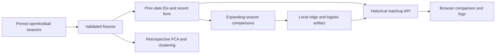

# Football Intelligence Engine

The analyst selects a historical Premier League season, date and two clubs.
The system estimates three outcome probabilities and signed goal difference,
then shows the recent scoring, conceding and points rates behind the forecast.

- [Dataset card](DATASET_CARD.md) documents sources, schema and temporal splits.
- [Validation results](VALIDATION_RESULTS.md) covers benchmarks, failure patterns
  and uncertainty. The reserved 2024–25 season remains sealed.
- [Product contract](PRODUCT_CONTRACT.md) connects the course families to
  scientific questions.
- [Operations](OPERATIONS.md) describes verification and failure handling.
- [Student learning guide](STUDENT_LEARNING_GUIDE.md) ties mathematics to code.
- [Course requirements](COURSE_REQUIREMENTS.md) tracks the preliminary evidence.

Scoring-profiles research describes completed seasons. The live profile table
uses the last five available matches before the selected historical date. The
first launch covers 2022–23 and 2023–24 using a model fitted through May 2022.
