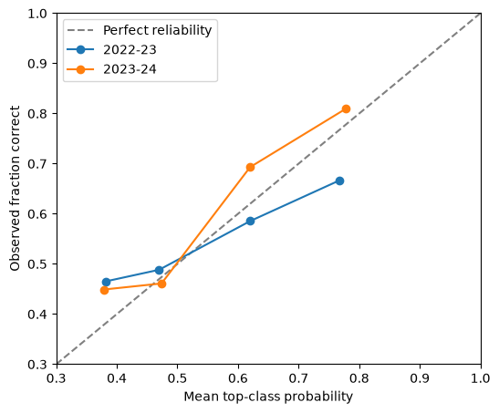
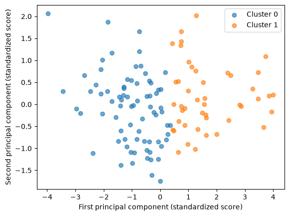

# Premier League validation results

This is preliminary scikit-learn reference evidence based on real openfootball
fixtures. The folds trained on 1,140 and 1,520 matches respectively and each
validated on 380. The [machine-readable report](evidence/reference-validation.json)
retains all candidates and subgroup metrics. The final test is sealed.

| Model and metric | 2022–23 | 2023–24 |
| --- | ---: | ---: |
| Training mean goal difference, MAE | 1.464 | 1.603 |
| Ridge goal difference, MAE | 1.367 | 1.367 |
| Ridge goal difference, RMSE | 1.751 | 1.794 |
| Training class frequency, log loss | 1.057 | 1.054 |
| Regularized logistic, log loss | 0.996 | 0.928 |
| Calibrated linear SVM, log loss | 1.007 | 0.975 |
| Small neural network, log loss | 1.028 | 0.945 |
| Regularized logistic, accuracy | 53.9% | 57.9% |
| Regularized logistic, balanced accuracy | 46.0% | 48.6% |
| Regularized logistic, multiclass Brier | 0.595 | 0.547 |

Ridge had the lowest MAE in both folds. Regularized logistic had the best
mean log loss, while the less regularized variant led by about 0.0002 in the
second fold. The SVM fitted its decision surface through the
penultimate training season and calibrated its scores on the latest
training season. The small neural model hit its 500-iteration cap in one
fold. Neighbors and shallow trees produced poor log loss, which can arise
when small neighborhoods or leaves attach zero probability to realized outcomes.
A paired 28-day calendar block bootstrap (1,000 draws) puts the 95% ridge
MAE gains versus mean at [0.049, 0.129] and [0.107, 0.362] goals in the two
folds. Logistic's gains versus class frequency were [0.043, 0.078] and
[0.061, 0.188] log-loss units. These intervals are conditional on the two
seasons and chosen fits. Repeat teams can induce dependence across blocks.

## Failure patterns

- Draw recall at argmax was zero in both folds, out of 87 and 82 actual draws.
  In 2022–23 the 213 matches in the 15–25% draw-probability bin drew 24.9%
  of the time versus a 20.6% mean estimate. The matching 2023–24 bin had 209
  matches and 21.1% observed draws versus a 21.3% mean estimate.
- At an Elo gap below 100, log loss was 1.048 and 1.045. The larger-gap
  slices were easier at 0.938 and 0.827. Sparse-history slices had just five
  matches in each fold.
- The second fold's mean away-club goals-against form was 0.36 training
  standard deviations higher. This is a simple shift diagnostic and does
  not establish a causal explanation for changing performance.
- The live bundle is fitted on the first fold's training data. Second-fold
  results above use an expanded fit as part of model comparison.

The highest confidence bin was overconfident in 2022–23, averaging 76.7%
confidence and 66.7% observed accuracy in 54 matches. Bin calibration here
is descriptive and limited by sample sizes.

## Retrospective team profiles

The PCA and K-means comparison used 120 club-seasons. The first two components
explained 67.0% and 15.4% of standardized profile variance. Reconstruction RMSE
was 0.419 standardized units. Two clusters led the silhouette comparison
(0.354) and matched across five alternative seeds. PC 1 combines higher scoring
with fewer goals conceded, consistent with a general strength axis. Repeated
clubs and the modest silhouette limit claims about discrete profiles.

